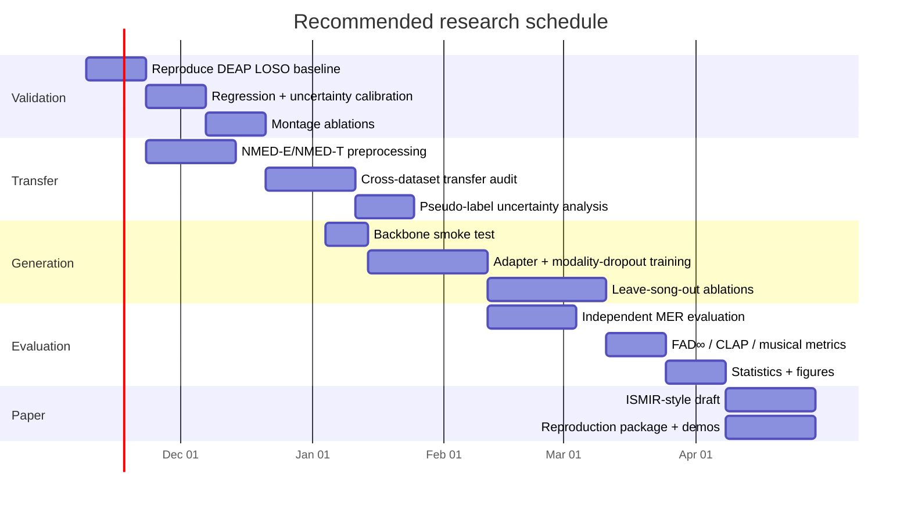
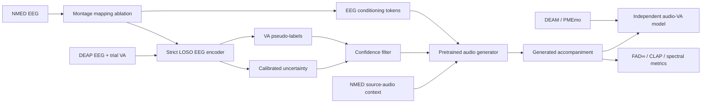

# Deep Research Report: EEG Emotion Transfer Across Datasets for Emotion-Conditioned Music Accompaniment

## Executive summary

The research brief asks for an exhaustive, primary-source-verified survey supporting a prospective ISMIR-style paper on **transferring EEG-based emotion models across datasets and using the transferred representation to condition music generation**. It explicitly requires careful separation of verified facts from interpretation, exact protocol reporting, identification of leakage, public/reproducible code and audio demos, quantitative-only evaluation, and clear marking of anything that cannot be verified. fileciteturn0file0

The ten most consequential findings are these. First, **Phase 1 is feasible but scientifically harder than headline DEAP results imply**: DEAP has one self-report per 60-s trial, not continuous emotional ground truth, and recent work demonstrates that participant identity can dominate pooled-window evaluations; one 2026 re-analysis found DEAP ROC-AUCs of 0.689/0.711 under epoch pooling but 0.493/0.447 under participant-independent evaluation for valence/arousal using the same feature family. citeturn435002search5 Second, subject-independent continuous VA regression is possible, but published numbers vary wildly with protocols; an explicitly LOSO study reported DEAP RMSE 1.902 for valence and 1.769 for arousal on the native 1–9 scale. citeturn435002search6 Third, **Phase 2 is the weakest scientific link**: transferring a DEAP emotion regressor directly to NMED-T changes subjects, cap density, acquisition system, stimulus set, experimental context, label distribution, and potentially cultural/music covariates simultaneously. Cross-dataset EEG work shows substantial transfer degradation even with explicit domain adaptation. citeturn117124search8turn117124search9

Fourth, montage conversion itself is technically tractable: current MNE can interpolate EEG to a new montage using spherical splines, and current Braindecode includes explicit pretrained-model channel mapping strategies including spline, inverse-distance, nearest-channel, source projection and learned latent mapping. citeturn117124search0turn117124search4 Fifth, **NMED-T has no valence/arousal annotations**; its behavioral labels are familiarity and enjoyment, while the original EEG data comprise 20 listeners, 10 full-length commercially available songs and 128-channel recordings, with cleaned and raw data available. citeturn360090search7 Sixth, the stimulus audio itself is not redistributed with NMED-T; the dataset supplies metadata/links, which creates an immediate reproducibility and licensing issue for public generated-audio demonstrations based on copyrighted source tracks. citeturn360090search3

Seventh, the broad idea is no longer unexplored. A 2025 ICASSP paper reconstructed naturalistic music from NMED-T using latent diffusion, and a June 2026 IEEE Transactions on Multimedia paper introduced EEG–music latent alignment followed by an EEG-conditioned diffusion-transformer/ControlNet pipeline. citeturn768370search5turn768370search7 Thus, the strongest novelty claim is **not “EEG-to-music generation”**, but potentially the combination of rigorous subject-independent emotion transfer, uncertainty-aware pseudo-labeling, cross-montage transfer, continuous VA conditioning, explicit anti-shortcut controls, and an emotion-regulation framing.

Eighth, **Phase 3 is technically feasible** with public pretrained generators. Stable Audio Open 1.0 is a 1B-parameter latent diffusion/DiT system producing stereo 44.1-kHz audio up to 47 seconds and has official fine-tuning infrastructure; JASCO natively supports multiple simultaneously optional conditions and condition dropout, while MusicGen-melody directly supports audio-derived melody conditioning. citeturn243808search6turn132786search0turn687367search6turn132786search6turn687367search3 Ninth, **10 songs are inadequate for claiming general EEG-conditioned music generation** unless the evaluation holds songs out: random temporal windows permit a model to exploit song identity, tempo, acoustic envelope and subject-specific responses rather than emotion. The fact that music identity is decodable from NMED-T is itself demonstrated by recent work, making shuffled-EEG and leave-song-out controls essential. citeturn491853search1 Tenth, a credible paper should frame itself as **offline affect-conditioned neural decoding/generation research, not clinical music therapy efficacy**; recent therapist co-design work supports human oversight, while controlled evidence for specific affect-regulation rules such as the iso principle remains mixed. citeturn181191search0turn181191search7

**Go/no-go assessment.** Phase 1: **GO**, provided the primary endpoint is strict LOSO regression and all windowing remains grouped inside subject/trial folds. Phase 2: **CONDITIONAL GO**, but only as an exploratory transfer/pseudo-label experiment whose validity is tested against alternative mappings and independent audio-side emotion estimates. Phase 3: **GO for a research prototype**, preferably with adapter/LoRA-style fine-tuning and leave-song-out evaluation; **NO-GO for clinical claims or training a generator from scratch**.

The five most dangerous risks are: subject/trial leakage in DEAP; pseudo-label distribution collapse under DEAP→NMED domain shift; stimulus-identity leakage from time-locked EEG; circular evaluation where the same emotion model produces and evaluates labels; and copyright/licensing limitations around NMED-T source music. citeturn435002search5turn360090search3

### Extracted instructions and assumptions

The following matrix consolidates the explicit questions, objectives, deliverables, constraints and evaluation criteria in `survey_prompt.txt`. Exact wording is preserved or minimally shortened where a single row represents a long enumerated clause. fileciteturn0file0

| Item | Type | Exact wording | Implied requirements |
|---|---|---|---|
| Project goal | objective | “Transferring EEG-based emotion modelling across datasets for emotion-conditioned music accompaniment” | Demonstrate transfer, not merely within-dataset performance |
| Phase 1 | objective | “Train an EEG encoder … on DEAP to regress continuous valence-arousal … Evaluate with LOSO” | Subject-independent regression and fold-safe preprocessing |
| Phase 2 | objective | “Harmonize NMED-T’s 128 channels to DEAP’s 32-channel montage … produce VA pseudo-labels … keep predictive uncertainty” | Montage mapping, domain transfer, calibrated uncertainty |
| Phase 3 | objective | “fine-tune a pretrained latent diffusion audio backbone (not from scratch)” | Public checkpoint, efficient adaptation, multimodal conditioning |
| Generation conditioning | constraint | “original audio gives musical context; separately encoded EEG embeddings and VA embeddings … via cross-attention” | Audio-to-audio/accompaniment rather than unconstrained generation |
| Optional modalities | deliverable | “Modality dropout enables EEG-only, VA-only and joint conditioning” | Ablation-capable conditioning design |
| Evaluation | criteria | “FAD, spectral characteristics, musical coherence, and MSE … target VA” | Objective-only metric suite |
| Compute | constraint | “4x H200 (shared)” | Efficiency matters, but moderate-scale fine-tuning is possible |
| Human evaluation | constraint | “No human listening test” | All conclusions must be based on quantitative proxies |
| Reproducibility | criteria | “Code and audio demos must be public and reproducible” | Licenses and redistributability must be checked |
| DEAP methods | question | “Strongest and most-cited methods since 2018” | Survey CNN/GNN/Transformer/foundation models |
| DEAP protocol | criteria | “proper subject-independent / LOSO … versus leaky trial- or segment-level splits” | Protocol auditing is central |
| DEAP regression | question | “Is continuous VA regression on DEAP meaningful …?” | Discuss label granularity and regression validity |
| DEAP preprocessing | question | “preprocessed .dat/.mat version, 128 Hz, baseline removal, windowing” | Reproducible preprocessing specification |
| Cross-montage | question | “spatial interpolation … channel-agnostic … 3D electrode-position embeddings” | Compare several harmonization strategies |
| Cross-dataset transfer | question | “train DEAP, test SEED/SEED-IV/DREAMER/AMIGOS/other” | Evidence of domain shift and adaptation |
| Pseudo-labeling | question | “MC dropout, ensembles, conformal” | Quantified uncertainty; confidence filtering |
| Direct DEAP→NMED evidence | question | “Is there any prior work that does exactly this?” | Explicit novelty search; say none if none found |
| NMED-T audit | deliverable | “Exact content … audio availability and license … preprocessing … ratings … size” | Dataset-card-level audit |
| NMED prior work | deliverable | “EEG-music decoding … tempo/beat … reconstruction” | Literature map for same dataset |
| Data sufficiency | question | “Whether 10 songs x 20 participants is enough” | Overfitting and split-design analysis |
| Alternative datasets | deliverable | “Survey all public datasets pairing EEG … with music listening” | Broad dataset comparison |
| Audio VA datasets | deliverable | “DEAM / PMEmo … continuous time-resolved VA” | Alternative emotion supervision |
| Brain-to-music | deliverable | “Brain2Music … EEG-conditioned … NeuroMusic … BCMI” | Closest prior generation work |
| Emotion-conditioned music | deliverable | “LARA-Gen … EMOPIA … MusicGen … Stable Audio …” | Control mechanisms and public implementation |
| Backbone comparison | deliverable | “licenses, parameter counts, sampling rates, checkpoints” | Deployment-oriented comparison |
| Multicondition CFG | question | “Modality dropout / classifier-free guidance … reference implementations” | Implementation pattern |
| Emotion-aware loss | question | “auxiliary emotion-regression … contrastive … RL/DPO … guidance” | Training objective alternatives |
| Audio-side MER | deliverable | “public checkpoints … R² / RMSE / CCC” | Independent evaluator selection |
| Generation metrics | deliverable | “FAD … KL … CLAP … MQAScore … tooling” | Multiple complementary metrics |
| EEG–audio alignment | question | “how much music-related information … is decodable from EEG” | Shortcut-risk and EEG-added-value analysis |
| Therapy context | question | “clinically sensible control signal … limits of claims” | Clinical restraint and ethics |
| Methodological risks | deliverable | “For each, say whether it is a real problem … mitigation” | Risk register with evidence |
| Fallbacks | deliverable | “2–3 reformulations … rank by feasibility and novelty” | Contingency plan |
| Novelty | question | “closest existing papers (2022–2026)” | Whole-pipeline and phase-level novelty |
| Paper design | deliverable | “3–5 concrete research questions / hypotheses and ablations” | Publishable experimental framing |
| Venues | deliverable | “ISMIR 2027, ICASSP …” | Format and positioning comparison |
| Resources | deliverable | “Hugging Face … GitHub … Scholar/arXiv … benchmarks” | Direct reproducibility resources |
| Output | constraint | “sections 1–11 in order … tables where possible” | Structured survey |
| Verification | criteria | “verify every claim against a primary source” | Primary-source hierarchy |
| Unsupported facts | criteria | “write ‘UNVERIFIED’ and say what you tried” | No silent inference |
| Dates | constraint | “today is 2026-11-03” | Recency cutoff and precise dating |

Assumptions made because the prompt leaves them unspecified: the intended audience is technically literate MIR/EEG researchers; “conference-paper target” means the survey should optimize for experimental decisions rather than pedagogy; no fixed report word count is specified; no submission deadline is specified; NMED-T source-audio rights are not assumed to permit redistribution; and public release of derived/generated clips should undergo a separate rights review.

## Evidence survey: EEG emotion recognition, transfer and datasets

**Section 1 — EEG emotion recognition on DEAP.** DEAP contains 32 participants, 40 one-minute music-video trials per participant, 32 EEG channels, and per-trial self-ratings including valence and arousal on a 1–9 scale. The official preprocessed version is downsampled to 128 Hz and includes standard artifact-cleaning/filtering steps; each trial also has a prestimulus baseline. citeturn243808search0turn243808search1turn243808search2

The main methodological conclusion is that **protocol quality matters more than small architectural differences**. TSception and LGGNet explicitly emphasize generalized or nested cross-validation rather than simple segment mixing. citeturn435002academia9turn435002search0 Recent evidence makes the leakage issue much sharper: subject identity can be predicted nearly perfectly from common qEEG features, and participant-independent emotion recognition may collapse to chance even when epoch-pooled evaluation looks respectable. citeturn435002search5

| Study/model | Task/data | Protocol/result worth retaining | Interpretation |
|---|---|---|---|
| TSception | DEAP, MAHNOB-HCI | Generalized cross-validation; architecture explicitly targets temporal scales and hemispheric asymmetry. citeturn435002academia9 | Suitable reproducible baseline |
| LGGNet | DEAP | Robust nested CV and graph/local-global spatial modeling. citeturn435002search0 | Strong architecture, but reproduce protocol exactly |
| Portable-EEG VA decoding study | DEAP/DREAMER/new data | LOSO regression; DEAP RMSE 1.902 valence, 1.769 arousal. citeturn435002search6 | Useful realistic regression baseline |
| Exact VA prediction study | DEAP/AMIGOS/DREAMER | Reports MAE <0.06, RMSE <0.16, PCC >0.80 across datasets. citeturn435002search7 | Numbers require careful protocol normalization before comparison |
| Subject-identity confound study | DEAP/DREAMER | DEAP ROC-AUC 0.689/0.711 pooled vs 0.493/0.447 participant-independent. citeturn435002search5 | Essential cautionary baseline |

Continuous VA regression on DEAP is mathematically possible, but its labels are **trial-level scalar judgments**, so assigning one label to every 1–5 s EEG window creates repeated targets rather than time-resolved affect ground truth. The correct claim is “regression of trial-level reported VA from short EEG windows,” not “continuous emotion decoding.” A continuous annotation corpus such as DEAM provides genuinely time-varying music-side labels and therefore solves a different supervision problem. citeturn148950search0

Recommended Phase-1 protocol: use the official DEAP preprocessed 128-Hz EEG; remove/preprocess baseline only within the documented procedure; create windows *after* assigning subject/trial groups; perform LOSO with all windows from the held-out subject completely absent from training, tuning and normalization-fit stages; report MAE, RMSE, Pearson \(r\), CCC if stable, plus subject-level confidence intervals. Binary high/low classification may be reported only as a literature bridge, not as the main scientific endpoint.

**Section 2 — Cross-dataset and cross-montage transfer.** MNE now supports interpolation directly onto a target EEG sensor configuration using spherical splines or minimum-norm methods, and its documentation explicitly describes spherical-spline interpolation as projection of scalp locations onto a sphere followed by reconstruction from neighboring electrodes. citeturn117124search0turn117124search1 Braindecode offers an unusually useful experimental framework because its ChannelLayer supports exact, zero, nearest, inverse-distance, spline, field, source, region, Wiener and learned latent channel mapping. citeturn117124search4turn117124search5

Therefore, “128→32 spherical interpolation” should **not** be a single irreversible preprocessing choice. It should be an ablation against: nearest named/positioned channels; common 10–20 subset; spherical spline; and, if using a pretrained foundation model, a native montage-aware adapter.

Cross-dataset EEG emotion recognition remains difficult. A 2026 multi-source domain-adaptation study reports DEAP↔SEED accuracies around the 40–60% range depending on direction and method, with CORAL/TCA/DDC/DAN often close to chance-level or modestly above it. citeturn117124search8 A separate cross-dataset consumer-EEG study found enormous degradation without anatomical mapping/domain adaptation and reported that CORAL and TCA materially improved transfer. citeturn117124search9 Pseudo-label methods are active research rather than a solved recipe; a 2026 EEG emotion paper explicitly combines adversarial adaptation with soft/hard pseudo-label refinement. citeturn117124search12turn117124search13

I found **no verified primary-source paper that exactly performs DEAP-trained VA regression → montage-harmonized NMED-T → VA pseudo-labels → emotion-conditioned audio generation**. Closely related components exist separately, but the exact chain remains distinct based on the sources located.

**Section 3 — NMED-T specifics.** The original ISMIR paper describes 20 participants hearing 10 complete commercially available songs; the songs have electronically produced beats in duple meter and span multiple tempos/genres. EEG was densely recorded, with both raw and cleaned data made available, and behavioral ratings include **familiarity and enjoyment**, not valence/arousal. citeturn360090search7 Raw recordings were acquired at 1 kHz; later work commonly uses the cleaned/downsampled 125-Hz representation. citeturn491853search1

Crucially, stimulus audio is not part of the downloadable dataset; metadata links are supplied instead. A secondary index reports about 39 GB total across 55 files, with cleaned per-song matrices in the 656–721 MB range and raw EEG files around 753–861 MB, but because I could not directly confirm those byte counts from the Stanford repository interface, **the precise 39-GB figure should be treated as UNVERIFIED until checked after download**. citeturn360090search3

Prior NMED-T work already shows that EEG contains enough stimulus-related information to decode music identity. A recent recognition model uses NMED-T for song identification, and an ICASSP 2025 paper goes much closer to your proposed endpoint by reconstructing naturalistic music from NMED-T EEG with latent diffusion. citeturn491853search1turn768370search5 That makes song-identity leakage a concrete, not hypothetical, concern.

**Section 4 — Alternative and complementary datasets.**

| Dataset | Participants/stimuli | EEG / physiology | Emotion labels | Audio availability / access | Suitability |
|---|---|---|---|---|---|
| DEAP | 32 × 40 one-minute music videos | 32 EEG + peripheral; preprocessed 128 Hz | Per-trial V/A/D/liking 1–9 | Gated academic dataset; original service status has changed. citeturn243808search0 | Phase-1 training |
| NMED-T | 20 × 10 full songs | 128-channel raw; cleaned representation commonly 125 ch/125 Hz | Familiarity/enjoyment, no VA | EEG public; source audio not redistributed. citeturn360090search7turn360090search3 | Phase-2/3 paired EEG–music |
| NMED-E | 23 × 4 stimuli | Raw and preprocessed EEG | Pleasantness, arousal, interest, predictability, familiarity | Open Stanford repository. citeturn491853search3turn360090search6 | Better affective NMED variant |
| DREAMER | 23 × 18 audiovisual stimuli | Emotiv EEG + ECG | V/A/D self-report | Public Zenodo. citeturn491853search6 | Cross-dataset validation |
| AMIGOS | 40; short + long videos | EEG/ECG/GSR | V/A/control/familiarity/liking/basic emotion | Public research dataset. citeturn148950search5 | Transfer benchmark |
| MAHNOB-HCI | ~27 usable emotion participants | 32 EEG + peripheral/video | V/A/D etc. | Gated research access. citeturn148950search4turn148950search8 | Transfer benchmark |
| OpenMIIR | 10 × 12 short music fragments | EEG perception + imagination | Music identity/task, not VA | Public-domain PDDL; several GB. citeturn491853search4turn491853search5 | EEG–music representation learning |
| DEAM | 1,802 excerpts/full songs | audio only | Per-second and whole-song VA | CC-licensed audio available; ~1.3 GB. citeturn148950search0 | Best audio-side continuous VA supervision |
| PMEmo | 794 songs, 457 annotators | audio + EDA | static + 0.5-s dynamic emotion | Chorus MP3s released; full songs restricted by copyright. citeturn148950search2turn148950search3 | Audio VA evaluator/training |
| EMOPIA | pop-piano corpus | symbolic MIDI + referenced audio | four emotion quadrants | MIDI released under CC BY-NC-SA; audio via IDs/timestamps. citeturn752684search4 | Symbolic affect-generation baseline |

NMED-H and related Stanford naturalistic EEG variants are worth checking, but NMED-E is especially relevant because it includes explicit **pleasantness and arousal ratings** while retaining the naturalistic-music/Stanford-family context. citeturn360090search6 This makes it a potentially stronger bridge than NMED-T for validating whether a DEAP-derived affect representation transfers at all.

## Generative modeling, audio emotion evaluation and EEG conditioners

**Section 5 — Emotion-conditioned and EEG-conditioned music generation.** The novelty landscape has changed materially by late 2026. Brain2Music demonstrated music reconstruction from fMRI by predicting MusicLM-related representations, with generated outputs preserving semantic properties such as genre, instrumentation and mood; MusicLM itself was proprietary, although later analysis code and source data were released. citeturn768370search0turn768370search2 EEG-driven emotional music systems also existed by 2024, including real-time emotion-to-music generation and transformer-based emotive generation. citeturn768370search3turn768370search4

Most important for novelty, an ICASSP paper titled *Naturalistic Music Decoding from EEG Data via Latent Diffusion Models* trains directly on NMED-T and quantitatively evaluates EEG-driven music reconstruction. citeturn768370search5 In June 2026, *Echoes of the Brain: Reconstructing Music from EEG via Latent Space Alignment and Guided Diffusion* introduced an EEG encoder aligned to a pretrained music encoder followed by EEG-conditioned diffusion-transformer ControlNet generation. citeturn768370search7 Any paper claiming “first EEG-conditioned diffusion music generation” would therefore be untenable.

Emotion-conditioned generation remains promising. LARA-Gen directly controls continuous valence/arousal and uses a frozen MERT-based emotion predictor for evaluation. citeturn752684academia8turn752684search0 EMOPIA provides an established four-quadrant symbolic generation benchmark. citeturn752684search4turn752684search5 The October 22, 2026 Dai–Tan–Yang paper reports that an in-context method improved held-out MER60 valence \(R^2\) from 0.110 to 0.427 with 80 text demonstrations; it is important mainly as evidence that **valence remains substantially harder than arousal** and that audio-side evaluators are still evolving. citeturn752684academia9

Backbone comparison:

| Backbone | Architecture / size | Audio context | Extra conditioning adaptability | License / practical note |
|---|---|---|---|---|
| Stable Audio Open 1.0 | latent autoencoder + T5 + DiT; 1B | Requires custom audio-to-audio/noising pathway for context | Strong: official training code and conditional architecture | Stability AI Community License; 44.1 kHz stereo, ≤47 s. citeturn243808search6turn132786search0turn687367search6 |
| Stable Audio Open Small | smaller DiT | Similar architecture | Good prototyping target | ≤11 s stereo 44.1 kHz; authors note stronger SFX than music. citeturn687367search5 |
| AudioLDM2-Music | latent diffusion, ~1.1B total | Can be extended via latent/noising conditioning | Cross-attention architecture is adaptable | CC BY-NC-SA 4.0; official music checkpoint. citeturn687367search0turn132786search4 |
| MusicGen-melody | autoregressive EnCodec LM, 1.5B | **Yes**, melody/chroma audio conditioning | Additional tokens require architecture work | Weights CC-BY-NC 4.0; 32 kHz. citeturn687367search3 |
| JASCO | flow-matching Transformer, 400M/1B | melody/drums/chords conditions | **Excellent multi-condition reference**; trained with condition dropout | Public AudioCraft models/code. citeturn132786search5turn132786search6 |
| Mustango | latent-diffusion-derived controllable music | Text + music-theory conditions | Demonstrates structured local controls | Public model/code. citeturn752684search6turn752684search7 |

For your exact architecture, **Stable Audio Open 1.0 is the most natural diffusion backbone**, while **JASCO is the strongest reference implementation for optional multimodal condition dropout**. MusicGen-melody is attractive if preservation of source melody/context is more important than diffusion specifically. Stable Audio’s official tooling supports fresh fine-tuning from pretrained unwrapped checkpoints, which fits the 4×H200 constraint. citeturn687367search6

A defensible multimodal conditioner would project EEG tokens and a small VA embedding into the generator’s condition dimension, train with independent Bernoulli dropout of EEG and VA branches, and retain an unconditional branch for classifier-free guidance. The four inference modes should be audio-context only, +VA, +EEG, and +VA+EEG, with shuffled-EEG and shuffled-VA negative controls.

Emotion-aware losses should be secondary rather than the only objective. A frozen audio-emotion predictor can supply \(\mathcal L_{VA}=\|\hat y_{\text{audio}}-y_{\text{target}}\|_2^2\), but it risks evaluator gaming. Better practice is to train with one predictor and evaluate with a separately trained model/dataset; contrastive EEG–audio or VA–audio alignment can supplement it. LARA-Gen’s use of an external MERT-derived predictor shows that this general pattern is already accepted experimentally. citeturn752684search0

**Section 6 — Audio-side music emotion recognition and generation evaluation.** A single VA predictor should not define success. Audio emotion models generalize poorly when genre, culture, mastering and annotation protocol shift, and the newest MER work still describes valence as notably more difficult than arousal. citeturn752684academia9 The best design is an evaluator ensemble: one DEAM-trained continuous VA regressor, one independently trained PMEmo/MER60-style regressor, and a semantic embedding model used only as a supplementary score.

FAD must also be reported carefully. Original FAD used VGGish-like embedding statistics and correlated more strongly with human quality judgments than several signal-level metrics in the original validation, but ICASSP 2024 showed that FAD is sensitive to sample size, reference-set quality and embedding choice; the authors recommend infinite-sample extrapolation and released `fadtk` with MERT, CLAP, EnCodec and VGGish options. citeturn944264search4turn944264search5turn944264search0 For a ten-song corpus, ordinary pooled FAD is particularly unstable.

Recommended quantitative evaluation:

| Dimension | Primary metric | Secondary metric | Main limitation |
|---|---|---|---|
| Emotion adherence | VA Euclidean/RMSE using **independent** MER model | Pearson/CCC by target trajectory | Predictor/domain bias |
| Audio quality/distribution | FAD∞ with MERT and/or CLAP-music | PANN/MERT FD | Small-N sensitivity |
| Musical semantics | CLAP music–condition similarity | MQAScore mood/theme component | Embedding evaluator bias |
| Context preservation | chroma/melody similarity to input | tempo/onset/spectral correlation | Can reward copying |
| Diversity | pairwise embedding dispersion | condition-wise entropy | Must separate desired variation from noise |
| EEG added value | joint − VA-only delta | permutation/shuffled-EEG effect | Requires paired repeated measures |

`fadtk` is currently the cleanest FAD implementation for music-oriented embeddings; `audioldm_eval` offers FAD/FD/KL/KID and signal metrics, while `av-benchmark` adds CLAP and multiple audio embeddings. citeturn944264search0turn944264search2turn944264search3 MQAScore was posted October 22, 2026 and evaluates fine-grained musical concepts via a large audio-language model; because it is extremely new and submitted for ICASSP 2027, it should be treated as an experimental supplementary metric rather than a headline endpoint. citeturn944264academia10

**Section 7 — EEG encoders and EEG–audio alignment.** The most practical foundation models are LaBraM, BIOT, EEGPT and CBraMod. LaBraM is an ICLR 2024 EEG foundation model pretrained on roughly 2,500 hours from multiple datasets and uses channel patches plus masked neural-code prediction. citeturn243808search9turn243808search10 BIOT explicitly handles varying channel counts, lengths and missing channels after frequency normalization. citeturn590148search3turn590148search4 EEGPT has an official NeurIPS 2024 repository, and CBraMod has an official ICLR 2025 implementation with released pretrained weights. citeturn590148search6turn590148search0 NeuroLM is much larger—up to 1.7B parameters—and pretrained on roughly 25,000 hours, but its language-oriented multi-task design is unnecessary for this project’s first experiments. citeturn590148search5

For conditioning a generator, LaBraM/EEGPT/CBraMod are more attractive than NeuroLM because the useful output is a compact sequence or pooled EEG representation, not generative language tokens. Current Braindecode support further reduces montage friction by exposing pretrained-model channel strategies directly. citeturn117124search4

The critical ablation question is whether EEG adds information beyond the source audio and the VA target. NMED-T studies show song identity is recoverable from EEG, which means a generator can exploit stimulus-related auditory entrainment instead of affect. citeturn491853search1 Therefore shuffled-EEG, temporally misaligned EEG, and leave-song-out evaluation are mandatory if the paper claims emotion-specific neural conditioning.

## Clinical framing, risks, novelty and positioning

**Section 8 — Music therapy and ethical framing.** CHI 2024 therapist co-design work found opportunities for musical AI in therapy while emphasizing the complexity of therapist–AI collaboration rather than autonomous substitution. citeturn181191search0turn181191search8 The generative-AI music-therapy paper in IEEE Transactions on Consumer Electronics proposes a closed-loop AIGC-oriented system and frames it as a future direction rather than established clinical efficacy. citeturn181191search1turn181191search2

Valence/arousal is a plausible **engineering control space**, not a validated clinical endpoint. The iso principle motivates matching a listener’s current state and gradually moving toward a target state, but a 2026 preregistered experiment found no significant difference between iso and compensatory listening for the primary comparison, despite some exploratory benefits of guided listening. citeturn181191search7 A separate 2026 neuroimaging study reported physiological/neural differences under an iso sequence, illustrating that the mechanism is plausible but not sufficient to establish therapy efficacy. citeturn181191search6

The paper should therefore say “foundation for adaptive music biofeedback” and “offline proof of concept,” not “music therapy treatment,” “emotion regulation efficacy,” or “clinical intervention.” Public EEG is sensitive biometric data; releases should preserve original consent/licensing boundaries and avoid identity-related claims, especially given evidence that participant identity is highly recoverable from EEG features. citeturn435002search5

**Section 9 — Methodological risk register.**

| Risk | Real problem? | Evidence | Mitigation |
|---|---|---|---|
| 60-s DEAP label copied to short windows | **Yes—major** | DEAP ratings are trial-level. citeturn243808search0 | Predict trial-level VA; aggregate window predictions before scoring |
| DEAP→NMED label/domain shift | **Yes—major** | Cross-dataset EEG transfer degrades substantially. citeturn117124search8turn117124search9 | Calibration on NMED-E or independent audio VA; uncertainty filtering |
| 128→32 interpolation changes statistics | **Yes—moderate** | Multiple montage mappings produce different reconstructed inputs. citeturn117124search4 | Ablate nearest/common-subset/spline/native channel-layer |
| EEG encodes song identity | **Yes—major** | NMED-T supports music identification and reconstruction. citeturn491853search1turn768370search5 | Leave-song-out split; shuffled and time-shifted EEG controls |
| Circular pseudo-label evaluation | **Yes—major** | Same model can trivially reinforce its own geometry | Independent audio MER evaluator and dataset |
| 20 subjects × 10 songs | **Yes—major for generalization** | Dataset dimensionality is tiny relative to modern generators. citeturn360090search7 | Freeze backbone, adapters only; subject/song bootstraps; permutation tests |
| FAD on tiny sets | **Yes** | FAD is sample-size biased. citeturn944264search5 | FAD∞, multiple embeddings, bootstrap CIs |
| Public source-audio demos | **Yes** | NMED-T does not redistribute source audio. citeturn360090search3 | Use legally redistributable fallback audio for public demos |

Statistical inference should operate at the **subject or subject×song level**, not at the window level. Report paired subject-level bootstrap confidence intervals and permutation tests where conditions are compared; treating thousands of overlapping windows as independent observations would grossly understate uncertainty.

Three fallback designs, ranked:

| Rank | Reformulation | Feasibility | Novelty |
|---|---|---|---|
| 1 | Use NMED-E to validate affect transfer, then NMED-T only for EEG–audio representation/generation | High | High-moderate |
| 2 | Train emotion-conditioned audio adaptation on DEAM/PMEmo, then test whether EEG-derived VA can replace ground-truth/audio VA | Very high | Moderate-high |
| 3 | Use DEAP’s own stimulus audio where legally/reproducibly obtainable, keeping EEG and emotion labels in one domain | Moderate | Moderate, but cleaner causally |

**Section 10 — Novelty and research questions.** The closest whole-pipeline work is now the 2026 EEG latent-alignment + guided-diffusion paper, while the closest NMED-T-specific work is the 2025 latent-diffusion reconstruction study. citeturn768370search5turn768370search7 LARA-Gen is the closest VA-control paper on the generation side. citeturn752684academia8 Your viable novelty is therefore **emotion transfer as an intermediate interpretable bridge plus uncertainty-aware cross-dataset transfer and rigorous anti-shortcut evaluation**, rather than EEG→music generation itself.

The strongest paper questions are:

1. **RQ1:** How much does strict LOSO performance of a DEAP VA regressor differ from pooled/segment-level evaluation?
2. **RQ2:** Which montage strategy preserves transferable DEAP emotion representations on NMED-family EEG: nearest/common subset, spherical spline, or montage-aware foundation-model mapping?
3. **RQ3:** Does uncertainty-filtered EEG-derived VA produce better emotion-aligned generation than unfiltered pseudo-labels, shuffled VA, or audio-only conditioning?
4. **RQ4:** Does EEG conditioning improve any metric over VA-only conditioning under **leave-song-out** testing, and does the gain survive shuffled/time-shifted EEG controls?
5. **RQ5:** How much of apparent EEG benefit is actually song-identity leakage, measurable through an auxiliary song-classification probe?

A convincing minimum ablation matrix is audio-context only / VA-only / EEG-only / joint EEG+VA / shuffled EEG / time-shifted EEG / random VA, crossed with interpolation strategy and uncertainty threshold.

**Section 11 — Resources and source hierarchy.** The highest-priority resources are the official NMED-T repository/paper; MNE and Braindecode montage tools; LaBraM, BIOT, EEGPT and CBraMod repositories; Stable Audio Tools; AudioCraft/JASCO/MusicGen; DEAM and PMEmo; and `fadtk`. citeturn491853search0turn117124search0turn117124search4turn243808search9turn590148search4turn590148search6turn590148search0turn687367search6turn132786search5turn148950search0turn148950search2turn944264search0

Useful literature-search strings are: `DEAP LOSO valence arousal regression EEG`; `DEAP subject independent leakage EEG emotion`; `"NMED-T" EEG reconstruction music`; `"NMED-T" DEAP`; `"EEG to music" diffusion`; `"EEG-conditioned" music generation`; `"cross-dataset" EEG emotion DEAP`; `"continuous valence arousal" music generation`; `"montage invariant" EEG transformer`; and `"pseudo label" EEG emotion domain adaptation`. These searches surfaced the most relevant 2024–2026 work cited above; I found no verified paper containing the exact full DEAP→NMED-T pseudo-label→emotion-conditioned generation chain.

## Recommended deliverable plan

The recommended primary design is: **DEAP for strict LOSO VA regression; NMED-E as a transfer-validation bridge if available; NMED-T for paired EEG–music experiments; DEAM/PMEmo for independent audio-emotion supervision/evaluation; Stable Audio Open 1.0 for diffusion fine-tuning; LaBraM or EEGPT as the first pretrained EEG encoder; and JASCO as the implementation reference for multimodal condition dropout**. This selection minimizes from-scratch training while directly addressing the largest scientific weaknesses. citeturn243808search9turn590148search6turn132786search0turn132786search6turn148950search0turn148950search2

The minimum experiment order should be deliberately failure-first. Smoke-test DEAP LOSO regression; if held-out-subject correlation is effectively zero, do not proceed to pseudo-label generation. Next test montage invariance on DEAP itself by synthetically reducing/remapping channels and measuring prediction degradation. Then test NMED-family transfer distributions and uncertainty. Only after those pass should generator adapters be trained. Finally run leave-song-out generation and shuffled controls.

For storage, download **metadata/code first**, then the DEAP preprocessed package, then cleaned NMED subsets rather than raw recordings, followed by DEAM annotations/audio and only one generator checkpoint. NMED-T is likely tens of GB in full; the quoted ~39-GB total is **UNVERIFIED from the primary repository in this research session** and should be checked before provisioning. citeturn360090search3 Stable Audio Open 1.0 is a 1B-parameter model; AudioLDM2’s Hugging Face repository is roughly 9 GB for the base checkpoint tree, illustrating why duplicate backbones should not be downloaded initially. citeturn243808search6turn687367search1

The recommended paper structure is approximately six scientific pages for an ISMIR-style submission: 0.5 page motivation/related work; 1 page datasets and protocol; 1.25 pages EEG regression and transfer; 1.25 pages generation method; 1.25 pages results/ablations; 0.5 page risks/limitations/ethics; figures and compact tables integrated throughout. ISMIR 2026 used a 6+N format—six scientific-content pages plus unrestricted reference/ethics-style pages—although **ISMIR 2027 rules must be rechecked when published**. citeturn731410search1turn731410search0 ICASSP 2027 allows four pages of technical content plus an optional fifth page restricted to references and specified statements. citeturn731410search2turn731410search3 TISMIR permits articles up to about 8,000 words, while Journal of Neural Engineering research papers are normally no more than 12,000 words. citeturn731410search4turn731410search5

A compact causal/experimental diagram for the paper should make the separation between pseudo-label production and independent evaluation explicit:

Resource needs are modest relative to the available hardware if the generator backbone is frozen or adapter-tuned: one GPU is enough for most EEG experiments, while 1–4 H200s can be reserved for audio-adapter training and batched evaluation. The principal scarce resource is not compute but **statistical independence and legally redistributable paired audio**.

## Prioritized bibliography

The following sources should be read first, in this order.

| Priority | Source | Why it matters | Verification |
|---|---|---|---|
| Essential | Koelstra et al., DEAP dataset | Defines labels, acquisition and intended use | Verified via dataset record. citeturn243808search0 |
| Essential | Losorelli et al., *NMED-T*, ISMIR 2017 | Primary NMED-T specification | Verified. citeturn360090search7 |
| Essential | Subject Identity Confounds qEEG Emotion Recognition, 2026 | Strongest leakage warning | Verified via PubMed. citeturn435002search5 |
| Essential | MNE montage interpolation documentation | Exact harmonization implementation | Verified official docs. citeturn117124search0 |
| Essential | Braindecode ChannelLayer | Montage-ablation framework | Verified official docs. citeturn117124search4 |
| Essential | *Naturalistic Music Decoding from EEG via Latent Diffusion*, ICASSP | Closest NMED-T generation work | Verified publication page. citeturn768370search5 |
| Essential | *Echoes of the Brain*, IEEE TMM 2026 | Closest EEG-alignment + diffusion pipeline | Verified IEEE record. citeturn768370search7 |
| Essential | LARA-Gen, 2025 | Continuous VA-control precedent | Verified arXiv/project page. citeturn752684academia8turn752684search0 |
| Essential | Stable Audio Open | Candidate diffusion backbone | Verified paper/model card. citeturn132786academia7turn132786search0 |
| Essential | JASCO | Multi-condition dropout precedent | Verified official AudioCraft docs. citeturn132786search5turn132786search6 |
| High | LaBraM, ICLR 2024 | Practical EEG foundation encoder | Verified official repo. citeturn243808search9 |
| High | BIOT, NeurIPS 2023 | Cross-format/channel EEG representation | Verified official repo. citeturn590148search4 |
| High | EEGPT, NeurIPS 2024 | Foundation-model baseline | Verified official repo. citeturn590148search6 |
| High | CBraMod, ICLR 2025 | Recent EEG foundation baseline | Verified official repo. citeturn590148search0 |
| High | DEAM | Continuous audio-side VA supervision | Verified official dataset. citeturn148950search0 |
| High | PMEmo | Dynamic emotion labels + physiology | Verified paper/repo. citeturn148950search2turn148950search3 |
| High | *Adapting FAD for Generative Music Evaluation*, ICASSP 2024 | Small-sample/FAD methodology | Verified IEEE/GitHub. citeturn944264search5turn944264search0 |
| High | Sun et al., CHI 2024 | Therapy co-design framing | Verified ACM. citeturn181191search0 |
| High | Schuller et al., generative-AI music therapy | Closed-loop therapy framing | Verified institutional/IEEE metadata. citeturn181191search1turn181191search2 |
| Recent | Dai, Tan & Yang, 2026 | State-of-the-art MER context, valence difficulty | Verified arXiv. citeturn752684academia9 |
| Recent | MQAScore, 2026 | New fine-grained generation evaluation | Verified arXiv; prepublication status. citeturn944264academia10 |

The central recommendation is therefore: **build the paper around rigorous transfer validity, not generation novelty alone**. A publishable contribution is plausible if Phase 1 uses genuinely subject-independent regression, Phase 2 is treated as a tested hypothesis rather than assumed-valid pseudo-labeling, and Phase 3 proves that EEG contributes beyond source-audio identity and VA alone under leave-song-out controls. If any of those three tests fail, the fallback using NMED-E plus DEAM/PMEmo remains scientifically coherent and substantially easier to defend.